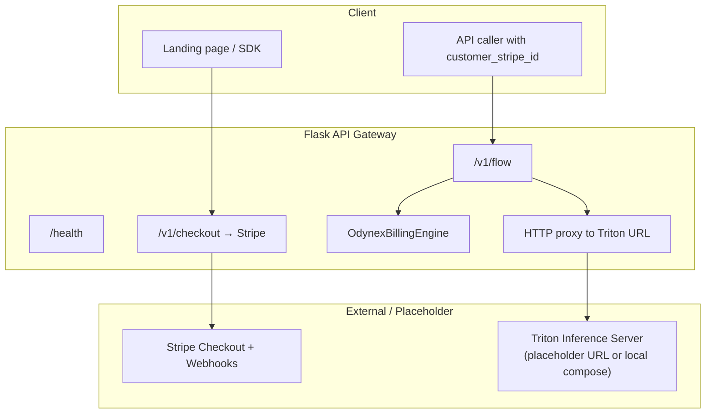
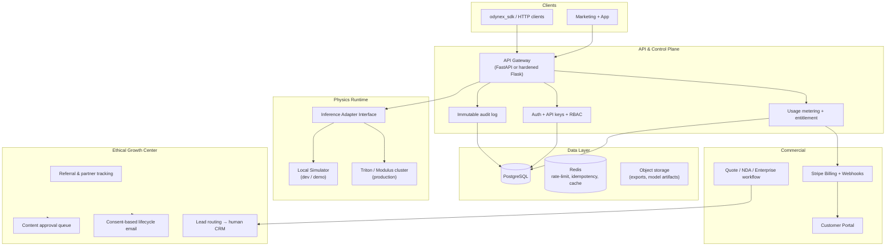
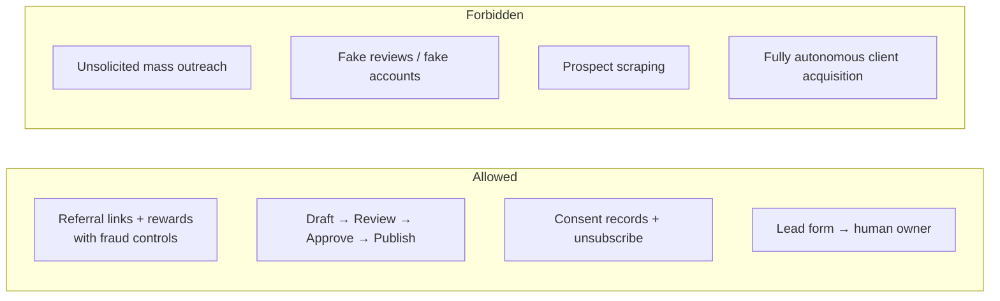

# Architecture — ScreeTC

**Status:** Current state (verified) + recommended production architecture for a commercially viable MVP.

---

## 1. Current Architecture (verified)

**Observed gaps**
- Triton endpoint is a placeholder.
- No trained model weights in repo.
- Billing entitlement is stub / in-memory.
- Secrets appear in environment **and** in one hard-coded path (must be removed).
- No durable database, no proper auth, no audit log.

---

## 2. Target Architecture (Industrial MVP)

---

## 3. Build-vs-Buy Decisions

| Capability | Decision | Rationale |
|------------|----------|-----------|
| Core PINN / physics models | Build (keep proprietary) | Core IP & TUTSA protection |
| API gateway + metering | Build on FastAPI or hardened Flask | Full control of usage events |
| Database | Buy managed Postgres | Reliability & backups |
| Auth / API keys | Build thin layer + optional enterprise SSO later | Simple for Axis Stream |
| Payments | Buy Stripe Billing + Customer Portal | Industry standard, fewer dark patterns |
| Email | Buy provider (Postmark, SES, etc.) with consent + unsubscribe | Deliverability + compliance |
| Object storage | Buy S3-compatible | Model artifacts & exports |
| Inference runtime | NVIDIA Triton / Modulus (production) + local simulator (dev) | Matches stated stack |
| CRM / e-signature | Abstraction + human-owned pipeline | Never auto-spam |

---

## 4. Security Architecture (required for MVP)

- All secrets exclusively from environment / secret manager. Fail closed if missing.
- Stripe webhook signature verification + idempotency keys.
- API keys hashed at rest; scoped and rotatable.
- Rate limiting per key and per IP.
- Tenant isolation tests for any multi-tenant path.
- Non-root containers; minimal attack surface.
- Structured audit log for entitlement changes, key issuance, and admin actions.
- Clear data-export and account-deletion flows.

---

## 5. Ethical Growth Architecture

Every external message or post requires an explicit human approval step by default.

---

## 6. Deployment Options

| Mode | Description |
|------|-------------|
| Multi-tenant SaaS (Axis Stream) | Shared control plane + metered inference |
| Region-isolated (Sovereign Gateway) | Dedicated or isolated tenant resources |
| Private / air-gapped (Odynex Core) | Customer-controlled deployment; quote + NDA + support contract |

Local development must work with the simulator only (no GPU required). Production GPU paths are explicit and documented.
